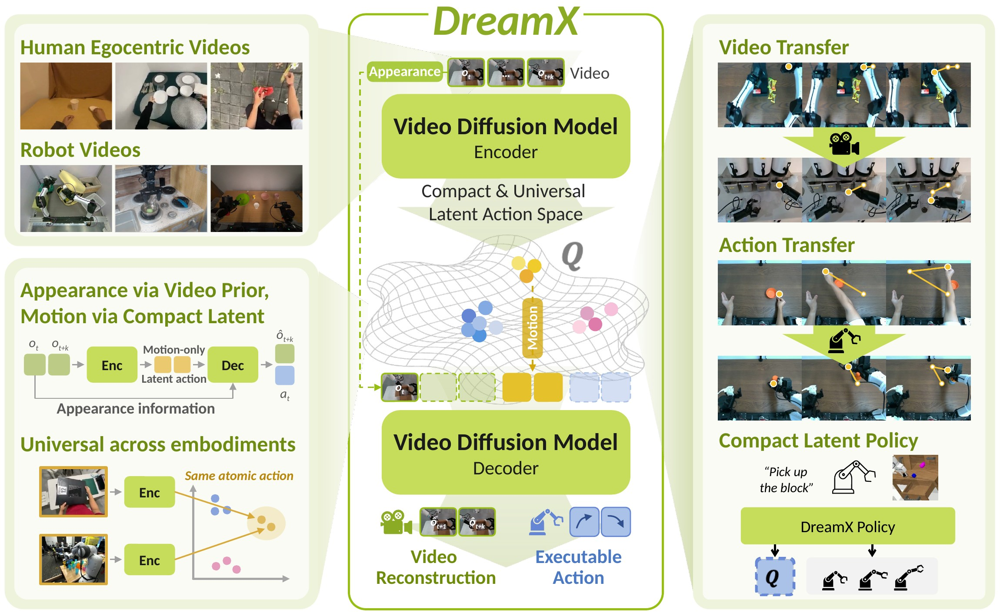

# DreamX: Video Diffusion Model is a Universal Latent Action Learner

[Jisoo Kim](https://jiiiisoo.github.io/)1\*, [Chaehyun Kim](https://kchyun.github.io/)1\*, [Junsu Kim](https://jjunos0926.github.io/)1, [Jiho Park](https://jihopark00.github.io/)1, [Seongchan Kim](https://scholar.google.com/citations?user=2DpCfdcAAAAJ&hl=ko)1, 
[Eunbeen Hong](https://eunbeen-hong.github.io/)1, [Soowon Son](https://soow0n.github.io/)1, [Fu-En Yang](https://fuenyang1127.github.io/)2, [Seungryong Kim](https://cvlab.kaist.ac.kr/members/faculty)1

1KAIST&emsp;2NVIDIA 
\*Equal contribution

DreamX reads compact latent actions out of a pretrained video diffusion model: one motion space for humans and robots alike.

## Code

Coming soon.
